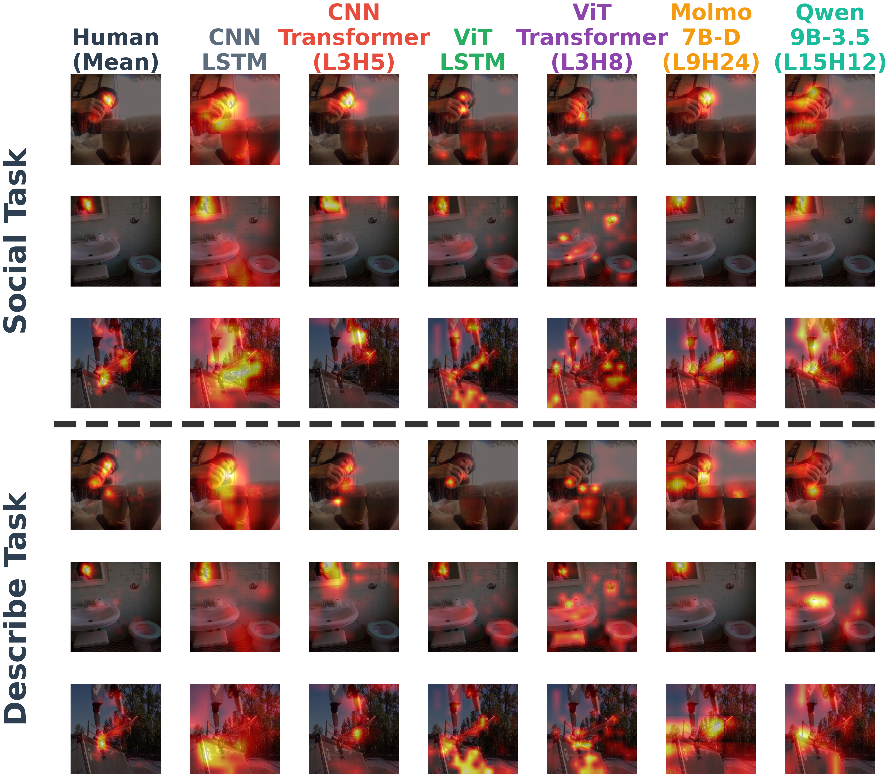

# Attention Alignment Between Humans and Vision-Language Models

[](https://arxiv.org/abs/2606.17410)
[](https://huggingface.co/isaacrc/vlm-attention-alignment)

Code and data for the paper:

> **Attention Alignment Between Humans and Vision-Language Models**  
> Isaac R. Christian, Udith Haputhanthri, Declan Campbell, Samuel Nastase, Taylor Webb, Michael Graziano  
> *NeurIPS 2026* · [arXiv:2606.17410](https://arxiv.org/abs/2606.17410)

We compared spatial attention maps from six vision-language models against human fixation heatmaps recorded on 200 images during two tasks (general description and social captioning). The six models span a 2×2 factorial of CNN vs. ViT encoders crossed with LSTM vs. Transformer decoders, plus Molmo 7B-D and Qwen3.5 9B. Decoder architecture dominates fixation alignment: LSTM decoders reach 80–87% of the human noise ceiling; Transformer decoders reach 40–59%.



---

## Repository Structure

```
models/          Model definitions and training scripts for all 4 factorial variants
inference/       Beam-search attention extraction (parametrized by condition × phase)
analysis/        Fixation alignment, RSA, between-task, and VLM head analysis scripts
neglect/         Hemispatial neglect simulation scripts
tribe/           TRIBE v2 neural encoding pipeline (exploratory; superseded by the NSD analysis)
rebuttal/        Analyses added in review (see "Camera-ready analyses" below)
  shared/        Shared alignment code: canonical checkpoints, subject exclusions, metrics, figure style
  task1_head_selection/  Cross-validated Transformer head selection
  task2_between_task/    Social vs. Describe map similarity
  task3_baselines/       Saliency baselines (Itti-Koch, GBVS, spectral residual)
  task4_metric_suite/    CC, SIM, NSS, AUC and sAUC alignment metrics
  task5_statistics/      Permutation tests and mixed-effects models
  task8_nsd/             Neural encoding of attention maps in the Natural Scenes Dataset
  plots/         Figure scripts for the review analyses
neurips_final/   Camera-ready figure scripts and final figures
  novlm_2026-10-23/      Scripts for the camera-ready figures (Figures 1-7, appendix)
  molmo_bilinear/, qwen35_nothink/  VLM attention re-extraction and checks
  final_figures/manuscript_2026-11-02/  Final manuscript figures (PNG)
figures/
  scripts/       Figure generation scripts (one script per manuscript figure)
  output/        Final manuscript figures (PNG)
results/
  correlations/  Precomputed alignment CSVs (model × subject × phase)
data/
  eyetracking/
    social/      Per-subject fixation heatmaps, Social task (n=27, ~2.3 GB, Git LFS)
    descriptive/ Per-subject fixation heatmaps, Describe task (n=22, ~2.2 GB, Git LFS)
  target_images.csv  List of 200 COCO val images used in the study
```

---

## Setup

```bash
conda env create -f environment.yml
conda activate cans-env
```

**Python path notes:** Training scripts for the architecture variants (`models/cnn_transformer/`, `models/vit_lstm/`, `models/vit_transformer/`) import shared utilities from `models/cnn_lstm/` (datasets, utils). Add `models/cnn_lstm/` to `PYTHONPATH` or copy those files alongside the training script before running.

---

## Path Configuration

Scripts contain absolute path constants at the top (e.g., `ARCH_DIR`, `RNN_DIR`, `GROUP_DIR`). Before running any script, update these to point to your local clone of this repository. A typical edit looks like:

```python
# Change from the original cluster path:
BASE = '/scratch/gpfs/GRAZIANO/CANS'
# To your local path:
BASE = '/path/to/vlm-attention-alignment'
```

---

## Data

### Eyetracking heatmaps (included, Git LFS)
Stored in `data/eyetracking/social/` and `data/eyetracking/descriptive/`. Each file is `{subject_id}_heatmaps.npy` — a dict `{image_name: 336×336 float32 array}` for 200 images.

```bash
# Pull LFS files after cloning
git lfs pull
```

### COCO val images (not included)
Download from the [COCO dataset](https://cocodataset.org/#download). The 200 stimuli are COCO val2017 images; val2017 is a subset of val2014, and the inference scripts read them from `val2014/`. The models were trained on the Karpathy splits of COCO 2014. The 200 target image names are in `data/target_images.csv`.

### Model weights (HuggingFace)
Pre-trained social-task checkpoints for all four models are available at:  
**[https://huggingface.co/isaacrc/vlm-attention-alignment](https://huggingface.co/isaacrc/vlm-attention-alignment)**

| Model | Best social checkpoint |
|---|---|
| CNN-LSTM | `cnn_lstm_social_best.pth.tar` |
| CNN-Transformer | `cnn_transformer_social_best.pth.tar` |
| ViT-LSTM | `vit_lstm_social_best.pth.tar` |
| ViT-Transformer | `vit_transformer_social_best.pth.tar` |

---

## Models

### Training pipeline (3 phases per model)

| Phase | Data | Encoder |
|---|---|---|
| Phase 1 — COCO pretrain | COCO 2014 captions (Karpathy splits) | Frozen |
| Phase 2 — COCO finetune | COCO 2014 captions (Karpathy splits) | Unfrozen |
| Phase 3 — Social finetune (`train_social_unfrozen.py`) | Social task captions | Unfrozen |

Describe-task analyses use the best Phase 2 checkpoint; Social-task analyses use the best Phase 3 checkpoint. `train_social_frozen.py` is an exploratory branch from Phase 2 that the paper does not use.

```bash
# Example: CNN-Transformer Phase 1
cd models/cnn_transformer
python train_phase1.py

# Example: ViT-LSTM social finetune
cd models/vit_lstm
python train_social_unfrozen.py
```

### Architecture summary

| Model | Encoder | Output | Decoder |
|---|---|---|---|
| CNN-LSTM | ResNet-101 | 14×14×2048 | LSTM + Bahdanau attention |
| CNN-Transformer | ResNet-101 | 14×14×2048 | 4-layer Transformer (8 heads, d=512) |
| ViT-LSTM | ViT-B/16 | 196×512 | LSTM + Bahdanau attention |
| ViT-Transformer | ViT-B/16 | 196×512 | 4-layer Transformer (8 heads, d=512) |

### Loading a checkpoint

```python
import torch, sys
sys.path.insert(0, 'models/cnn_transformer')
from model import Encoder, TransformerDecoderWithAttention

ck = torch.load('cnn_transformer_social_best.pth.tar', map_location='cpu')
encoder = Encoder(); encoder.load_state_dict(ck['encoder']); encoder.eval()
decoder = TransformerDecoderWithAttention(...); decoder.load_state_dict(ck['decoder']); decoder.eval()
```

---

## Reproducing Results

### 1. Extract attention maps (per model × phase)
```bash
cd inference
python extract_beam5.py --condition CNN_Transformer --phase social_unfrozen
python extract_beam5.py --condition ViT_LSTM --phase social_unfrozen
# Saves ckpt_cache/{phase}_beam5_E{epoch:03d}.npz
```

### 2. Compute fixation alignment
```bash
cd analysis
python compute_correlations.py --condition CNN_Transformer --phase social_unfrozen
# Writes correlations/spatial_corr_{phase}.csv, rsa_corr_{phase}.csv, caption_cosine_{phase}.csv
```

### 3. Per-head analysis (Transformer variants)
```bash
cd analysis
python head_attention_analysis.py --condition CNN_Transformer --layer 3
python head_attention_rsa.py --condition ViT_Transformer --layer 3
```

### 4. Between-task alignment
```bash
cd analysis
python between_task.py
```

### 5. Hemispatial neglect simulation
```bash
cd neglect
python run_neglect.py --condition CNN_LSTM
python plot_neglect.py
```

### 6. TRIBE neural encoding (exploratory)
```bash
cd tribe
python 1_tribe_inference.py       # requires TRIBE v2 weights (facebook/tribev2)
python 2_feature_extraction.py
python 3b_banded_encoding_model.py
python m6c_combined_panel.py
```

### Reproduce manuscript figures directly
Precomputed correlation CSVs in `results/correlations/` allow figures to be regenerated without re-running the analysis:

```bash
cd figures/scripts
python plot_fig3_alignment.py      # Fig 3: fixation alignment bars
python plot_fig4_taskdiff.py       # Fig 4: between-task differentiation
python plot_fig5_attn_by_task.py   # Fig 5: attention maps by task
python plot_neglect.py             # Neglect simulation figure
```

### Camera-ready analyses
The analyses reported in the camera-ready version live in `rebuttal/` and `neurips_final/`. Canonical
checkpoints, subject exclusions (Describe n = 22) and the human ceilings are defined in
`rebuttal/shared/alignment_core.py`. The neural encoding analysis (`rebuttal/task8_nsd/`) needs the
Natural Scenes Dataset, which is not redistributed here; request access at
[naturalscenesdataset.org](https://naturalscenesdataset.org). Summary results (CSV) are included;
large intermediate arrays (`.npy`, `.npz`) are not.

---

## VLMs

Molmo 7B-D and Qwen3.5 9B were run with no fine-tuning. Their pre-extracted attention maps are analyzed by:
- `analysis/vlm_head_molmo.py` — per-head spatial alignment (Molmo)
- `analysis/vlm_head_qwen35.py` — per-head spatial alignment (Qwen3.5)
- `analysis/vlm_between_task.py` — between-task differentiation for VLMs

Model weights are not included. Download from:
- Molmo: [allenai/Molmo-7B-D-0924](https://huggingface.co/allenai/Molmo-7B-D-0924)
- Qwen3.5: [Qwen/Qwen3.5-9B](https://huggingface.co/Qwen/Qwen3.5-9B)

---

## Citation

```bibtex
@article{christian2026attention,
  title={Attention Alignment Between Humans and Vision-Language Models},
  author={Christian, Isaac R. and Haputhanthri, Udith and Campbell, Declan and Nastase, Samuel and Webb, Taylor and Graziano, Michael},
  journal={arXiv preprint arXiv:2606.17410},
  year={2026}
}
```
